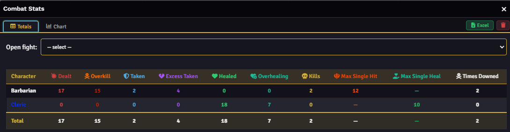
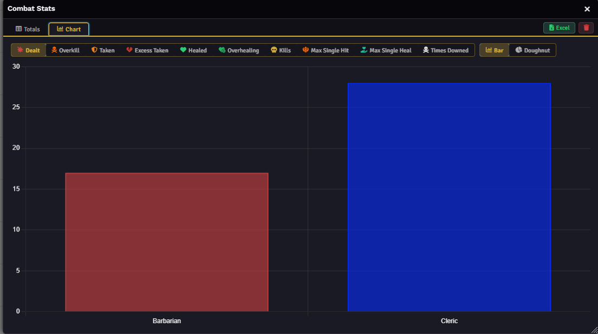
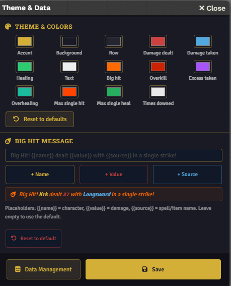

# ⚔️ Combat Stats

> Your party deserves more than a forgotten roll. Combat Stats tracks every hit, heal, and kill, and makes sure no one forgets who carried the fight.


[](https://ko-fi.com/smantella)
[](https://discord.com/users/191284272726933506)

Combat Stats 4.x uses one release line for **Foundry VTT 13 and 14**. Use a D&D 5e system version compatible with your Foundry installation; the old 2.x/3.x split does not describe the current release line.

---

## 📸 Screenshots

| Totals Table | Chart View |
|:---:|:---:|
|  |  |
| **End-of-Combat Card** | **Theme & Settings** |
|  |  |

## What it does

Combat Stats is a Foundry VTT module for D&D 5e that records combat statistics for each character, fight by fight, across your campaign. When a recorded combat is deleted, it saves the results and posts a summary to chat. Open the Combat Stats window to browse totals, compare characters, inspect damage by ability, and export the history.

Choose your tracker mode, reload Foundry, and run a combat.

## ✨ Features

### 📊 Character and enemy statistics

- **Damage dealt** and **damage taken**.
- **Healing done**.
- **Kills**, **maximum single hit**, **maximum single heal**, and **times downed**.
- **Overkill**, **excess damage taken**, and **overhealing**, using the extra information available in MidiQOL workflows.
- **Average d20**, with the number of recorded rolls in the statistics window and Excel export.
- **Minion kills**, tracked separately when the optional Minion! integration is enabled.

Enable **Track enemy stats** to record NPC statistics too. These are aggregated by Actor in separate Enemies sections of the statistics window. Enemy statistic rows do not appear in the party's chat summary; the defeated enemies list has its own display settings.

Native tracking uses the HP changes exposed by D&D 5e. It cannot recover damage or healing that was rolled but never applied, or the unapplied portion beyond an HP limit.

### 🎲 Average d20

See each character's average **natural retained d20 result**, without modifiers. Includes standard attack rolls, saving throws (including concentration), ability checks, skill checks, tool checks, and initiative during a tracked combat.

Discarded advantage/disadvantage dice and discarded reroll results do not count. Damage dice, death saves, cancelled roll dialogs, and fixed initiative scores without a d20 are excluded. Initiative is captured from core initiative chat messages, including individual and bulk rolls.

The chat card shows a white d20 icon and the average. The statistics window and Excel export also show the roll count. Overall averages use **sum of results ÷ total roll count**, rather than averaging each combat's average.

Historical combats without d20 data show **—**. Custom rolls that bypass the system roll events and core initiative messages are not included. Frequent advantage can raise the average: this measures retained results rather than pure luck.

### 💬 End-of-combat chat card

The compact recap includes configurable columns for **Kills**, **Damage dealt**, **Damage taken**, and **Healing done**, plus **Average d20**. Hover over an icon to see its label. Character names use their Foundry player colors.

A **Big Hit** callout can highlight the largest strike. Customize its threshold and message, with `{{name}}`, `{{value}}`, `{{source}}`, and `{{round}}` placeholders and a live preview.

Set **Chat message sender (Actor ID)** to post the recap as a chosen Actor. Leave it empty to use the default **⚔️ Combat Stats** alias.

### 🕵️ Control defeated enemy names

Choose **Defeated enemy names** in module settings:

| Option | Result |
|---|---|
| **Actor names** | Display the defeated Actor's name. |
| **Token names** | Display the name recorded for the individual token. |
| **Hidden** | Omit the defeated enemies list. |

This applies to chat summaries, the statistics window, and Excel exports. Use **Enemy Names for Current Combat** in the scene controls for a per-combat override. For saved fights, click **Enemy Names** in the Single Fight view.

In Token names or Hidden mode, aggregated enemy statistics are GM-only because their labels use Actor names. Token names must be safe to reveal; this is not automatic integration with third-party name-hiding modules. These settings control presentation, not access to stored world data. Existing chat messages are unchanged. Older records without token names display **Unknown enemy** in Token names mode.

### 💀 GM kill corrections and revival

An enemy survived with 2 HP, but you decided the attack was enough? Select its token and click **Correct Kill Credit (Selected Enemy)** in the Combat Stats scene controls.

- **Assign / Reassign Kill** awards or transfers the credit to a character.
- **Remove Kill** removes that token's credit.

These commands update the kill count and defeated list without changing HP, damage, or maximum-hit statistics. Each correction affects one token, including individual victims of an area attack. Only the active GM can make corrections during the currently tracked combat. Minion victims use the separate minion counter.

**Undo kills when enemies regain HP** is enabled by default. When the same enemy token returns above zero HP, its current credit is removed so a later final blow can receive credit. Disable this if later resurrection should preserve the earlier credit. This applies to normal enemies and tracked minions in the current combat.

### 🧙 Summons and transformed characters

Creatures created through the D&D 5e Summon activity are attributed to their summoner. Wild Shape and Polymorph attribution also resolves transformed forms back to the original character when supported system data is available.

The optional **Attribute player-owned NPCs to their player** setting broadens attribution to player-owned NPCs. Use it deliberately: story NPCs assigned to players may also match. **Ask who a summon belongs to** lets the GM identify newly created NPCs that cannot be attributed automatically.

### 📈 Charts and damage by ability

Browse campaign totals, individual fights, and history charts. Compare supported metrics with **Bar**, **Doughnut**, or **Trend** views. Chart colors follow Foundry player colors.

The Abilities view ranks damage by ability, with hits, average damage, maximum hit, and share of total damage. Select multiple characters to compare their breakdowns.

### 🎨 Theme and data management

Customize statistic colors, backgrounds, accents, and the Big Hit message from **Theme & Data**.

- **Export to Excel**: fight sheets and campaign summaries, including d20 averages and available minion counts.
- **Export JSON**: portable combat history for backups or sharing.
- **Import JSON**: merge by fight ID to avoid duplicates, or replace the history.
- Clear history or remove saved fights using the GM controls.

## 🤝 Plays well with Minion!

[**Minion!**](https://foundryvtt.com/packages/minion-bang), by [therealsega87](https://github.com/therealsega87), automates the minion rules from MCDM's *Flee, Mortals!* on top of MidiQOL, including overkill and optional shared turns and bands.

With a compatible Minion! build, Combat Stats records **minion kills separately from normal kills**. The chat kill cell displays **normal kills (minion kills)** — for example, **2 (5)** — and character tables and Excel exports include a **Minion kills** column. Extra overkill victims do not duplicate the original attack's damage.

**Track Minion! kills** appears in Combat Stats settings only when Minion! is active and is enabled by default. Separate tracking requires the Minion! public kill API and event **schema 1**; Combat Stats warns the GM if that API is unavailable. The integration handles duplicate notifications, unknown attackers, global encounters, revival, and the existing GM correction commands. Minion events must belong to the tracked, started combat. Historical kills are not reclassified.

Get Minion! from its [Foundry package page](https://foundryvtt.com/packages/minion-bang), or read the guide and report issues on its [GitHub repository](https://github.com/therealsega87/minion-bang).

## 📦 Installation

### Foundry Package Manager

1. Open **Add-on Modules → Install Module**.
2. Paste this manifest URL:

   ```text
   https://github.com/Smantella/combat-stats/releases/latest/download/module.json
   ```

3. Install Combat Stats and its required dependency, **socketlib**.
4. Enable the modules in your world and reload Foundry.

### Manual installation

Download the runtime ZIP from [GitHub Releases](https://github.com/Smantella/combat-stats/releases) and extract its contents into **`Data/modules/combat-stats/`**. The `module.json` file must be directly inside that folder. Enable the module and socketlib, then reload Foundry.

Runtime ZIPs contain only the files Foundry needs. Tests, optional macro examples, screenshots, and documentation are maintained in the source repository.

## 🚀 Quick start

1. Open **Game Settings → Module Settings → Combat Stats**.
2. Choose a tracker mode matching your damage workflow, then reload Foundry.
3. Create a combat and confirm its name when prompted.
4. Run the encounter. Start the combat before expecting Minion! kill notifications to count.
5. Use **End Combat** to delete the encounter and save its recap. Merely pausing it does not finalize the statistics.
6. Open **Combat Stats** from the scene controls to browse saved results.

## ⚙️ Configuration and requirements

### Tracker mode

| Mode | Use when |
|---|---|
| **D&D 5e Standard** | Using the native D&D 5e damage workflow. |
| **MidiQOL — Auto apply damage** | MidiQOL applies damage automatically. |
| **MidiQOL — Manual apply damage** | Damage is applied manually from the MidiQOL workflow. |

Match Combat Stats to MidiQOL's own **Auto apply damage to target** setting. Reload Foundry after changing either setting. The MidiQOL choices are disabled when MidiQOL is inactive; a saved incompatible mode produces a warning.

### Tracking, display, and access

- **Tracked Statistics** contains controls for supported tracked statistics and the four core chat columns. The d20 average is displayed separately.
- **Name display in recap** selects full name, first name, last name, or Foundry username.
- **Players can view charts** grants non-GM users access to the statistics window.
- **Count AoE as a single hit** controls whether multi-target damage is combined for the maximum-hit tracker.
- **Big hit threshold** defaults to 30; set it to 0 to disable the callout.

### Compatibility

| Component | Requirement |
|---|---|
| Foundry VTT | Versions 13–14, as declared in the manifest. |
| D&D 5e | Minimum 5.3.0; compatibility updates target 6.0.6. Choose a system release compatible with your Foundry version. |
| socketlib | Required for relaying player-originated tracking data to the GM. |
| MidiQOL | Optional; select the matching tracker mode when using its damage workflow. |
| Minion! | Optional; separate minion tracking requires its schema 1 kill API. Follow Minion!'s own system and dependency requirements too. |

Native HP updates are processed once by the active GM. Player-originated action attribution and d20 data use socketlib where required. Avoid running incompatible versions of Foundry, D&D 5e, or automation modules together.

After updating, reload Foundry and start a new combat. New statistics are recorded from that point onward; historical records and existing chat cards are not rebuilt automatically.

## 🤝 Contributing and support

Issues and pull requests are welcome. If something breaks or you have an idea, [open an issue](https://github.com/Smantella/combat-stats/issues) or reach me on Discord For bugs, include your Foundry, D&D 5e, Combat Stats, and automation module versions, the selected tracker mode, and steps to reproduce.

[](https://ko-fi.com/smantella)
[](https://discord.com/users/191284272726933506)

## 📄 License

[Creative Commons Attribution-ShareAlike 4.0](https://creativecommons.org/licenses/by-sa/4.0/): you may use and modify this module with attribution to the original author and distribution of adaptations under the same license.

*Made by [Smantella](https://github.com/Smantella)* 🏰
